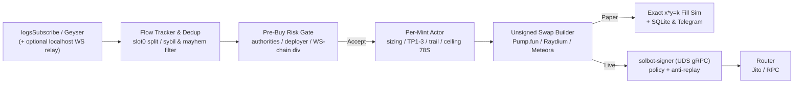

<div align="center">


# Tachyon

**Low-overhead Solana DEX execution engine, on-chain flow filter, and paper/live sniper workspace in Rust.**


[Architecture](#architecture) | [What Makes It Different](#what-makes-it-different) | [Quick Start](#quick-start) | [Configuration](#configuration) | [Backtesting](#tick-recorder-and-backtesting) | [Signer Isolation](#signer-isolation)

</div>

---

> [!WARNING]
> **Research software - paper-first by default.**
> Tachyon is an engineering workspace built to test on-chain microstructure hypotheses on Solana without burning capital on blind assumptions. Live execution is gated behind strict fail-closed checks and requires an isolated signer daemon. Nothing here is financial advice or a guaranteed edge.

<details>
<summary><b>Кратко на русском (RU)</b></summary>

**Tachyon** - модульный Rust-движок для анализа микроструктуры запусков на Solana (в первую очередь кривых Pump.fun, а также парсеров/билдеров под Raydium и Meteora), записи полного тикового потока и торговли в paper/live режимах.

Ключевые особенности:
- Декодирование сырых бинарных событий `CreateEvent` / `TradeEvent` прямо из `logsSubscribe` за доли миллисекунды (`0.1-0.4 мс` на расчёт фильтров и сборку транзакции в Rust).
- Защита от фейкового объёма: отделение Jito-бандлов нулевого слота (`slot0`) от реального органического притока, отсев пылевых кошельков (`< 0.05 SOL`), детектор мутаций виртуальных резервов (`Mayhem`), проверка истории деплоера и фильтр рассинхрона `WS vs on-chain`.
- Честная математика `x * y = k`: учёт комиссий протокола/автора, собственного price impact, многоступенчатых тейков (`TP1/TP2/TP3`), трейлинга, таймаута флэта и принудительного выхода на `~77.7 SOL` до заморозки кривой при миграции на `85 SOL`.
- Экономный сетевой контур: локальный WebSocket ретранслятор (`127.0.0.1:18900`) для запуска нескольких стратегий (A/B тестов) поверх одного внешнего соединения + лимитированный фоллбэк на резервный WS.
- Изолированный подписант `solbot-signer` в отдельном процессе по Unix socket (gRPC over UDS) с защитой от реплеев, лимитами позиции и `mlock` / `zeroize`.

</details>

---

## Why This Exists

Most open-source Solana "sniper bots" fail for three predictable reasons:
1. They buy `Create` at `t=0` over public WebSockets (`500-900ms` late) and become exit liquidity for `0-slot` Jito bundles.
2. Their paper mode fakes fills at flat mid-price without curve impact, fees, or exit latency, making losing strategies look profitable.
3. They keep private keys inside the same process that parses untrusted RPC payloads.

Tachyon was built from the opposite end: record every raw tick first, model exact constant-product curve fills with real latency and fees, filter out sybil/bundle flow before touching an actor, and isolate key material behind a separate UDS gRPC boundary.

---

## What Makes It Different

- **Raw Borsh log decoding (`trade_recorder`)** - decodes Pump.fun `CreateEvent` and `TradeEvent` payloads straight out of `Program data:` frames without extra `getTransaction` calls. Hot-path filtering and unsigned swap construction take `~0.1-0.4ms`.
- **Anti-sybil microstructure filters** - separates creation-slot Jito bundle volume (`slot <= birth_slot + 1`) from post-launch organic flow, ignores `< 0.05 SOL` sybil dust wallets, rejects dynamic virtual-reserve curves (`Mayhem`), checks 6h deployer history on-chain, and drops entries when lagging WebSocket state diverges from on-chain reserves (`SOLBOT_MAX_WS_CHAIN_DIVERGENCE_SOL`).
- **Exact bonding-curve physics** - paper fills and live sizing compute real `x * y = k` reserve math, protocol + creator fees, own price impact, multi-tranche exits (`TP1 / TP2 / TP3`), trailing high-water stops, early momentum timeouts, and a pre-graduation ceiling guard (`~77.7 SOL`) before the `85 SOL` migration freeze.
- **Zero-bloat multi-bot A/B testing** - primary node can expose a localhost WebSocket fan-out relay (`SOLBOT_WS_RELAY_BIND=127.0.0.1:18900`) so secondary strategy processes run side-by-side on the exact same tick stream without hitting per-IP RPC limits or burning paid WebSocket credits.
- **Crash recovery & state hydration** - open positions, state transitions, and circuit-breaker counters persist in SQLite (`WAL` mode) and rehydrate on restart.

---

## Architecture

The workspace splits responsibilities across 6 crates:

| Crate | Role |
|---|---|
| `solbot-common` | Shared domain types, position state machine, YAML config loaders, OpenTelemetry setup. |
| `solbot-strategy` | Signal ingestion, flow tracker, tick recorder, pre-buy risk gate, per-mint actors, DEX tx builders, router, SQLite state. |
| `solbot-signer` | Isolated signing daemon (gRPC over Unix Domain Socket), monotonic sequence ledger, intent policy checks, audit log. |
| `solbot-notify` | Internal broadcast event bus for lifecycle and risk alerts. |
| `solbot-telegram` | Per-instance Telegram bot (`/status`, `/positions`, `/pnl`, `/kill_switch`, `/resume`) + SMTP fallback. |
| `solbot-cli` | Operator / diagnostic CLI utilities. |



### Supported DEX Parsers & Builders
- **Pump.fun** - primary battle-tested path (bonding curve math, flow tracker, graduation ceiling guard, tick recorder).
- **Raydium** - AMM v4, CPMM, CLMM swap builders and account parsers.
- **Meteora** - DLMM and Dynamic AMM v2 builders.

*(Note: Raydium and Meteora modules provide builders/parsers, while the active microstructure research loop is focused on Pump.fun).*

---

## Quick Start

### Prerequisites
- Rust stable (`rust-toolchain.toml`)
- `protoc` (for `proto/signer.proto` in `build.rs`)
- SQLite3 development libraries

### Build & Run (Paper Mode)

```bash
cargo build --release --bin solbot-strategy --bin solbot-telegram
```

Create a minimal `.env` in the working directory:

```ini
SIGNAL_SOURCE=helius_logs
HELIUS_WS_URL=wss://api.mainnet-beta.solana.com
SOLBOT_FALLBACK_WS_URL=wss://mainnet.helius-rpc.com/?api-key=YOUR_KEY
SOLBOT_FALLBACK_BUDGET_SECS_PER_HOUR=600
SOLBOT_RPC_URL=https://mainnet.helius-rpc.com/?api-key=YOUR_KEY

SOLBOT_PAPER_TRADING=true
SOLBOT_PUBLIC_RPC=true
SOLBOT_SKIP_SIMULATE_SELL=true
DATABASE_URL=sqlite:solbot.db?mode=rwc

# Example strategy profile (Late-Stage Graduation Magnet)
SOLBOT_WS_BREAKOUT_TRIGGER=true
SOLBOT_MIN_POOL_SOL=38.0
SOLBOT_MAX_POOL_SOL=55.0
SOLBOT_MAX_INITIAL_POOL_SOL=25.0
SOLBOT_MIN_ORGANIC_SOL=12.0
SOLBOT_MIN_UNIQUE_BUYERS=20
SOLBOT_MAX_SELL_RATIO=0.50
SOLBOT_MAX_CONFIRM_DROP_PCT=0.06
SOLBOT_MIN_POOL_AGE_SECS=8
SOLBOT_MAX_POOL_AGE_SECS=300
SOLBOT_MAX_WS_CHAIN_DIVERGENCE_SOL=2.5

SOLBOT_POSITION_SIZE_SOL=0.5
SOLBOT_HARD_SL_PCT=0.12
SOLBOT_TP1_MULT=1.45
SOLBOT_TP1_SELL_PCT=0.65
SOLBOT_TP2_MULT=1.80
SOLBOT_TP2_SELL_PCT=0.25
SOLBOT_TP3_MULT=2.30
SOLBOT_TP3_SELL_PCT=0.10
SOLBOT_TRAILING_ACTIVATION_PCT=0.14
SOLBOT_TRAILING_DISTANCE_PCT=0.04
SOLBOT_MOMENTUM_TIMEOUT_SECS=20
SOLBOT_MOMENTUM_MIN_IMPULSE_PCT=0.03
SOLBOT_MAX_HOLD_SECS=90
```

Launch the strategy engine (and optional Telegram bot):

```bash
./target/release/solbot-strategy --paper
./target/release/solbot-telegram
```

### Running Parallel A/B Instances on One Host

To run a second strategy without opening a second upstream `logsSubscribe` stream:
1. Add `SOLBOT_WS_RELAY_BIND=127.0.0.1:18900` to Bot #1's `.env`.
2. Point Bot #2's `.env` to `HELIUS_WS_URL=ws://127.0.0.1:18900`, set `SOLBOT_RECORD_TRADES=false`, a separate `DATABASE_URL`, `METRICS_PORT=9091`, and a separate `TELEGRAM_BOT_TOKEN`.

---

## Configuration

Key environment variables grouped by subsystem:

| Group | Variables | Notes |
|---|---|---|
| **Connectivity** | `SIGNAL_SOURCE`, `HELIUS_WS_URL`, `SOLBOT_FALLBACK_WS_URL`, `SOLBOT_FALLBACK_BUDGET_SECS_PER_HOUR`, `SOLBOT_RPC_URL`, `SOLBOT_WS_RELAY_BIND` | Budgeted fallback caps paid WS usage per hour during public node hiccups. |
| **Entry & Anti-Sybil** | `SOLBOT_MIN_POOL_SOL`, `SOLBOT_MAX_POOL_SOL`, `SOLBOT_MAX_INITIAL_POOL_SOL`, `SOLBOT_MIN_ORGANIC_SOL`, `SOLBOT_MIN_UNIQUE_BUYERS`, `SOLBOT_MAX_SINGLE_BUY_SOL`, `SOLBOT_MAX_WALLET_CUM_SOL`, `SOLBOT_MAX_SLOT_INFLOW_SOL`, `SOLBOT_MAX_WS_CHAIN_DIVERGENCE_SOL` | Controls `slot0` bundle cap, anti-whale split-bundle limits, and WS/chain lag guard. |
| **Exits & Sizing** | `SOLBOT_POSITION_SIZE_SOL`, `SOLBOT_HARD_SL_PCT`, `SOLBOT_TP1_MULT`..`TP3_MULT`, `SOLBOT_TRAILING_ACTIVATION_PCT`, `SOLBOT_TRAILING_DISTANCE_PCT`, `SOLBOT_MOMENTUM_TIMEOUT_SECS`, `SOLBOT_MAX_HOLD_SECS` | Standard 30-SOL curves also enforce an automatic `~77.7 SOL` ceiling exit before migration freeze. |
| **Safety & Ops** | `SOLBOT_PAPER_TRADING`, `SOLBOT_PUBLIC_RPC`, `SOLBOT_SKIP_SIMULATE_SELL`, `SOLBOT_KILL_SWITCH_PATH`, `DATABASE_URL`, `METRICS_PORT`, `SOLBOT_BOT_LABEL` | Live mode refuses to boot if `SOLBOT_PUBLIC_RPC=true` or `SOLBOT_SKIP_SIMULATE_SELL=true`. |
| **Telegram** | `TELEGRAM_BOT_TOKEN`, `TELEGRAM_CHAT_ID`, `SMTP_*` | Interactive commands + real-time trade lifecycle alerts. |

---

## Tick Recorder and Backtesting

Enable passive CSV tick recording on the primary instance:

```ini
SOLBOT_RECORD_TRADES=true
SOLBOT_RECORD_DIR=logs/trades
SOLBOT_RECORD_WINDOW_SECS=1200
```

This writes hourly files (`logs/trades/YYYY-MM-DD-HH.csv`) containing raw `Create` (`C`) and `Trade` (`T`) events with exact virtual reserves (`vsol`, `vtok`) and slot numbers.

Evaluate hypotheses offline with realistic entry/exit latency and fees using `scripts/backtest.py`:

```bash
python3 scripts/backtest.py load logs/trades
python3 scripts/backtest.py search logs/trades 200 42
```

Every tested hypothesis - both working and failed - is documented with forensic post-mortems in [STRATEGY_JOURNAL.md](./STRATEGY_JOURNAL.md).

---

## Signer Isolation

`solbot-strategy` never touches private keys. For live execution, `solbot-signer` runs as an independent OS process communicating over a Unix socket (`/tmp/solbot-signer.sock`):

- **Monotonic sequence ledger** (`ipc_sequence_ledger`) prevents replay of signed intents.
- **Policy enforcement** validates program allowlists, maximum lamport spend (`SOLBOT_MAX_SIZE_LAMPORTS`), slippage caps (`SOLBOT_HARD_CAP_BPS_LIMIT`), intent freshness, and abnormal signing velocity before signing.
- **Memory hygiene** applies `mlock`, core-dump disabling, and `zeroize` on key material paths.
- **Key sources** support encrypted keyfiles (`SOLBOT_KEYPAIR_PATH` + `SOLBOT_KEYPAIR_PASSWORD`) or explicit dev env vars.

Never commit `.env`, `*.db`, or `*.pem` / keypair files to git.

---

## Development & Checks

```bash
cargo check --workspace --all-targets
cargo clippy --workspace -- -D warnings
cargo test --workspace
```

Integration, property, and chaos test suites live under `tests/simulate`, `tests/property`, and `tests/chaos`.

---

## Disclaimer

Provided **AS IS** for research and educational experimentation on Solana market microstructure. On-chain trading carries severe execution, smart-contract, RPC, and liquidity risks. Audit every line of the live routing and signing path and test with dust sizes before risking real funds.
