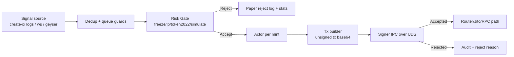

<div align="center">


# Tachyon Solana Sniper Bot (Experimental)
</div>

> ⚠️ **Статус проекта: experimental / work in progress / paper-first.**
>
> Этот репозиторий — исследовательский Rust workspace для проверки execution pipeline/sniper-подхода в Solana.
> Это **не завершённый продукт**, **не production-ready бот**, **не гарантия прибыли** и **не финансовая рекомендация**.

---

## Что это

Проект исследует связку:

1. детекция событий создания пулов/кривых и related create-событий;
2. технические pre-buy проверки (risk-gate);
3. сборка неподписанных swap-транзакций для нескольких DEX;
4. paper execution (dry-run) и журналирование;
5. изолированное подписание через отдельный signer-процесс по Unix socket (gRPC over UDS).

## Чего это НЕ делает

- не является «кнопкой денег»;
- не обещает устойчивый edge;
- не предоставляет завершённый production live-контур;
- не снимает с оператора риски инфраструктуры (RPC, задержки, деградации источников сигналов, проскальзывания и т.д.).

---

## Текущий статус и границы

- Основной фокус реализации: `solbot-strategy` + `solbot-signer`.
- По умолчанию runtime ориентирован на **paper-first** (`SOLBOT_PAPER_TRADING=true`, если явно не включать live).
- В live есть fail-closed ограничения (например, отказ старта при unsafe профиле RPC / отключённом simulate_sell).
- В коде есть частично реализованные и/или placeholder-зоны (особенно в ряде debug/binary и некоторых signal path).
- `solbot-cli`, `solbot-notify`, часть ops/deploy и alpha-слой — на разных стадиях зрелости, местами это заготовки.

---

## Архитектура workspace

`Cargo.toml` workspace включает 6 crates:

- `crates/solbot-common` — общие типы, ошибки, конфиг-структуры, OTel init/spans.
- `crates/solbot-strategy` — основной pipeline: signal intake, dedup/filter, risk-gate, actor loop, tx building, routing, paper logging, state/hydration.
- `crates/solbot-signer` — отдельный signer-сервис (gRPC over Unix socket), anti-replay ledger, audit log, валидация intent, подпись.
- `crates/solbot-notify` — event bus + события уведомлений.
- `crates/solbot-telegram` — Telegram отправка + fallback SMTP для critical alerts.
- `crates/solbot-cli` — административный CLI (сейчас в основном логирующие/каркасные команды).

---

## Поток выполнения (signal → decision → tx)



Ключевая идея: buy path в actor идёт только после `RiskGateVerdict::Accept`.

---

## Источники сигналов и DEX (только то, что подтверждено кодом)

### Источники сигналов

- `SIGNAL_SOURCE=helius_logs` (дефолт): create-ix через `logsSubscribe`.
- `SIGNAL_SOURCE=helius_ws`: account update поток через Helius WS.
- `SIGNAL_SOURCE=geyser_grpc`: account update поток через Geyser.
- `SIGNAL_SOURCE=both` / `helius_both`: комбинированный режим.

Также есть override `SOLBOT_CREATE_IX=true` для принудительного включения create-ix источника.

### DEX/программы, для которых есть парсинг/билдеры

- Pump.fun
- Raydium AMM v4 / CPMM / CLMM
- Meteora DLMM / DAMM v2 (dynamic)

Важно: наличие модуля/билдера в коде не равно «production-ready исполнению».

---

## Risk-gate и ограничения проверок

Risk-gate выполняет pre-buy проверки (включая timeout/fail-closed поведение):

- mint/freeze authority checks;
- LP lock checks (по поддерживаемым программам/форматам);
- Token-2022 extension checks;
- simulate_sell checks.

Параметры чувствительны к RPC-профилю:

- `SOLBOT_PUBLIC_RPC=true` — более «мягкие» таймауты (paper/debug профиль);
- `SOLBOT_PUBLIC_RPC=false` — ожидается private/fast RPC профиль для live.

Live-старт блокируется, если конфигурация небезопасна (например, `SOLBOT_SKIP_SIMULATE_SELL=true` или public RPC профиль).

---

## Paper mode и live mode

### Paper mode (основной текущий режим)

- включается `--paper` или `SOLBOT_PAPER_TRADING=true`;
- не требует signer IPC для старта;
- пишет журнал в `logs/paper_trades_YYYYMMDD.log` (или `SOLBOT_PAPER_TRADE_LOG_DIR`).

### Live mode (ограниченно, не считать готовым)

- требует корректной настройки signer (`SOLBOT_SIGNER_SOCKET`) и ключевого материала;
- ожидает строгий RPC-профиль (`SOLBOT_PUBLIC_RPC=false`) и живую инфраструктуру;
- часть окружения/операционки/маршрутизации остаётся в стадии разработки и проверки.

---

## Изолированный signer и модель безопасности

`solbot-signer` запускается отдельным процессом и принимает intent’ы по Unix socket (`/tmp/solbot-signer.sock` по умолчанию):

- anti-replay через `ipc_sequence_ledger`;
- audit trail через `signer_audit_log`;
- intent validation (program allowlist, возраст intent, лимиты размера/слиппеджа, destination checks, sequence monotonicity);
- rate anomaly detection;
- попытка защиты key material (mlock / core dump ограничения / zeroize в соответствующих путях).

Ключевой материал может быть загружен из:

- encrypted file (`SOLBOT_KEYPAIR_PATH` + `SOLBOT_KEYPAIR_PASSWORD`);
- dev/test env (`SOLBOT_KEYPAIR_JSON`, `SOLBOT_KEYPAIR_BASE58`, `SOLBOT_KEYPAIR_FILE`).

Никогда не коммитьте секреты и ключи в репозиторий.

---

## Структура репозитория

```text
.
├── Cargo.toml
├── proto/
│   └── signer.proto
├── migrations/
├── config/
├── crates/
│   ├── solbot-common/
│   ├── solbot-strategy/
│   ├── solbot-signer/
│   ├── solbot-notify/
│   ├── solbot-telegram/
│   └── solbot-cli/
├── tests/
│   ├── simulate/
│   ├── property/
│   └── chaos/
├── deploy/
└── scripts/
```

---

## Требования и установка

### Требования

- Rust stable (см. `rust-toolchain.toml`)
- `protoc` (используется в build.rs для gRPC/proto)
- SQLite dev libs (для `sqlx/sqlite`)

### Быстрый старт (paper)

```bash
# в корне репозитория
cargo build -p solbot-strategy --release
cargo run -p solbot-strategy --release -- --paper
```

---

## Env-конфигурация

В репозитории **нет** `.env.example` на текущий момент.

Создайте `.env` вручную и указывайте только нужные значения для вашего сценария.

### Минимум для paper

| Переменная | Назначение | Статус |
|---|---|---|
| `SIGNAL_SOURCE` | выбор источника сигналов (`helius_logs` и т.д.) | обязательна (рекомендуется явно) |
| `HELIUS_API_KEY` | ключ Helius для WS/logs и/или RPC fallback | условно обязательна |
| `SOLBOT_RPC_URL` | RPC URL для strategy/risk-gate | обязательна для осмысленной работы |
| `SOLBOT_PAPER_TRADING` | paper режим (`true`/`false`) | обязательна (рекомендуется явно) |
| `SOLBOT_PUBLIC_RPC` | профиль public/private RPC | опциональна (по умолчанию зависит от режима) |

### Для live/signer (экспериментально)

| Переменная | Назначение | Статус |
|---|---|---|
| `SOLBOT_SIGNER_SOCKET` | путь к UDS socket signer | обязательна для live |
| `SOLBOT_KEYPAIR_JSON` / `SOLBOT_KEYPAIR_PATH`+`SOLBOT_KEYPAIR_PASSWORD` / `SOLBOT_KEYPAIR_FILE` / `SOLBOT_KEYPAIR_BASE58` | источник ключа signer | обязательна для signer |
| `SOLBOT_MAX_SIZE_LAMPORTS` | абсолютный лимит размера intent | опциональна |
| `SOLBOT_HARD_CAP_BPS_LIMIT` | лимит hard cap bps в signer | опциональна |
| `SOLBOT_DEST_WHITELIST` | whitelist destination адресов signer | опциональна |
| `SOLBOT_SIGNING_RATE_THRESHOLD` | порог аномальной скорости подписания | опциональна |
| `SOLBOT_ALLOW_SYSTEM_PROGRAM` | разрешить System Program (тестовый флаг) | экспериментальная |

### Часто используемые runtime/debug переменные

| Переменная | Назначение | Статус |
|---|---|---|
| `DATABASE_URL` | SQLite URL для strategy (`sqlite:solbot.db` и т.п.) | опциональна |
| `SOLBOT_DB_PATH` | DB path для signer (`sqlite:../../solbot.db`) | опциональна |
| `METRICS_PORT` | порт `/metrics` | опциональна |
| `SOLBOT_PRE_BUY_RPC_TIMEOUT_MS` | timeout pre-buy RPC | опциональна |
| `SOLBOT_MAX_SIGNAL_AGE_MS` | stale cutoff по возрасту сигнала | опциональна |
| `SOLBOT_MAX_CONCURRENT_SIGNALS` | лимит параллельной обработки | опциональна |
| `SOLBOT_MAX_QUEUE_DEPTH` | ограничение backlog очереди | опциональна |
| `SOLBOT_SKIP_SIMULATE_SELL` | отключить simulate_sell (paper/debug) | экспериментальная/unsafe для live |
| `SOLBOT_CREATE_IX` | принудительно включить create-ix source | опциональна |
| `SOLBOT_SIGNAL_WARMUP_SECS` | warmup для seen-cache в create-ix source | опциональна |
| `OTEL_EXPORTER_OTLP_ENDPOINT` | endpoint OTel экспорта | опциональна |

### Переменные для telegram/alerts

| Переменная | Назначение | Статус |
|---|---|---|
| `TELEGRAM_BOT_TOKEN`, `TELEGRAM_CHAT_ID` | Telegram alerts | опциональны |
| `SMTP_HOST`, `SMTP_PORT`, `SMTP_USER`, `SMTP_PASS`, `ALERT_RECIPIENT_EMAIL` | SMTP fallback для critical alerts | опциональны |

---

## Команды запуска и проверки (реальные)

### Основные бинарники

```bash
cargo run -p solbot-strategy --release -- --paper
cargo run -p solbot-signer --release
cargo run -p solbot-telegram --release
cargo run -p solbot-cli --release -- --help
```

### Полезные strategy bins

```bash
cargo run -p solbot-strategy --release --bin paper_pipeline_e2e
cargo run -p solbot-strategy --release --bin solbot-benchmark
cargo run -p solbot-strategy --release --bin performance_benchmark
cargo run -p solbot-strategy --release --bin stage_1_2_check
cargo run -p solbot-strategy --release --bin helius_ws_debug
cargo run -p solbot-strategy --release --bin helius_logs_debug
```

В `crates/solbot-strategy/src/bin/` есть дополнительные служебные/debug binaries (`dex_listener_debug`, `queue_depth_diagnostic`, `test_*`, `e2e_devnet_test`, `devnet_roundtrip`, и т.д.) — воспринимайте их как инженерные инструменты, а не как стабильный пользовательский интерфейс.

### Сборка/проверка/тесты

```bash
cargo check --workspace --all-targets
cargo clippy --workspace -- -D warnings
cargo test --workspace
```

Также есть:

- crate-level tests (`crates/solbot-strategy/tests/...`);
- root tests в `tests/simulate`, `tests/property`, `tests/chaos`.

---

## Логи и диагностика

Ориентиры в логах strategy:

- сообщения о включённых signal sources;
- `Risk gate ACCEPT` / `Risk gate REJECT` + причина;
- дропы `queue_overflow` / `stale` / `bad_mint`;
- финальные и периодические `PIPELINE STATS`;
- `paper_trade_log` события (`ACCEPT`, `REJECT`, `PAPER_BUY`, `PAPER_SELL`).

Signer логи:

- старт, гидрация anti-replay ledger;
- `Intent ACCEPTED and signed` / `Intent REJECTED`;
- причины отклонения validation pipeline.

---

## Известные ограничения и риски

- Проект находится в активной разработке; интерфейсы и поведение могут меняться.
- Некоторые модули/бинарники содержат placeholder/TODO участки.
- Не все YAML-конфиги из `config/` гарантированно полностью подключены в runtime path.
- `solbot-cli` команды сейчас в основном каркасные/логирующие.
- Live execution критически зависит от качества RPC/infra и корректности ручной настройки.
- Наличие anti-rug/risk-gate не означает «безопасную торговлю».

---

## Roadmap (без завышенных обещаний)

Приоритеты развития в текущем состоянии:

1. доведение стабильности signal intake + risk-gate на реальном потоке;
2. выравнивание/чистка live path (router/signer/recovery) до предсказуемого fail-closed поведения;
3. доработка и формализация alpha-layer/labeling (часть уже отражена в migrations/config как база);
4. улучшение наблюдаемости, диагностик и сценариев аварийного восстановления;
5. повышение тестового покрытия для интеграционных и chaos-сценариев.

---

## Разработка и контрибьютинг

- Делайте небольшие и проверяемые изменения.
- Перед PR желательно прогонять:
  - `cargo check --workspace --all-targets`
  - `cargo clippy --workspace -- -D warnings`
  - `cargo test --workspace`
- Для SQLx/SQLite миграций проверяйте совместимость с текущими тестами и state/repo слоями.
- Не добавляйте секреты/ключи в git.

---

## Лицензия и дисклеймер

- В репозитории сейчас нет явного `LICENSE` файла; перед коммерческим/публичным использованием уточните лицензионный статус у владельца репозитория.
- Проект предоставляется в исследовательских целях. Вы самостоятельно несёте ответственность за любые действия и риски, связанные с использованием кода.
