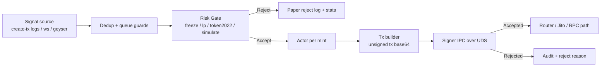

<div align="center">


# ⚡ Tachyon — Solana Sniper Bot

**Experimental · Paper-first · Rust workspace**

*Экспериментальный · Paper-first · Rust workspace*


[Overview](#-overview--обзор) •
[Architecture](#-architecture--архитектура) •
[Quick Start](#-quick-start--быстрый-старт) •
[Configuration](#-configuration--конфигурация) •
[Security](#-signer--security-model--signer-и-модель-безопасности) •
[Limitations](#-known-limitations--известные-ограничения)

</div>

---

> [!WARNING]
> **Project status: experimental / paper-first.**
> This repository is a research Rust workspace for validating an execution pipeline / sniping approach on Solana.
> It is **not a finished product**, **not a production-ready bot**, **not a profit guarantee**, and **not financial advice**.
>
> **🇷🇺 Статус проекта: experimental / paper-first.**
> Этот репозиторий — исследовательский Rust workspace для проверки execution pipeline / sniper-подхода в Solana.
> Это **не завершённый продукт**, **не production-ready бот**, **не гарантия прибыли** и **не финансовая рекомендация**.

---

## 📖 Overview / Обзор

### What it is

The project explores the following chain:

1. Detection of pool / curve creation events and related create-events.
2. Technical pre-buy checks (**risk-gate**).
3. Building unsigned swap transactions for several DEXes.
4. Paper execution (dry-run) with journaling.
5. Isolated signing through a separate signer process over a Unix socket (gRPC over UDS).

### What it is NOT

- ❌ Not a "money button".
- ❌ Makes no promise of a sustainable edge.
- ❌ Not a finished production live loop.
- ❌ Does not remove infrastructure risks from the operator (RPC, latency, degraded signal sources, slippage, etc.).

<details>
<summary><b>🇷🇺 Русский</b></summary>

### Что это

Проект исследует связку:

1. детекция событий создания пулов/кривых и related create-событий;
2. технические pre-buy проверки (**risk-gate**);
3. сборка неподписанных swap-транзакций для нескольких DEX;
4. paper execution (dry-run) и журналирование;
5. изолированное подписание через отдельный signer-процесс по Unix socket (gRPC over UDS).

### Чего это НЕ делает

- ❌ не является «кнопкой денег»;
- ❌ не обещает устойчивый edge;
- ❌ не предоставляет завершённый production live-контур;
- ❌ не снимает с оператора риски инфраструктуры (RPC, задержки, деградации источников сигналов, проскальзывания и т.д.).

</details>

---

## 🧭 Current Status & Boundaries / Текущий статус и границы

- Main implementation focus: `solbot-strategy` + `solbot-signer`.
- Runtime is **paper-first** by default (`SOLBOT_PAPER_TRADING=true` unless live is explicitly enabled).
- Live mode has fail-closed guards (e.g. refuses to start with an unsafe RPC profile or when `simulate_sell` is disabled).
- Some code areas are partial or placeholders (especially several debug binaries and some signal paths).
- `solbot-cli`, `solbot-notify`, parts of ops/deploy and the alpha layer are at different maturity levels — some are scaffolding.

<details>
<summary><b>🇷🇺 Русский</b></summary>

- Основной фокус реализации: `solbot-strategy` + `solbot-signer`.
- По умолчанию runtime ориентирован на **paper-first** (`SOLBOT_PAPER_TRADING=true`, если явно не включать live).
- В live есть fail-closed ограничения (например, отказ старта при unsafe профиле RPC / отключённом `simulate_sell`).
- В коде есть частично реализованные и/или placeholder-зоны (особенно в ряде debug/binary и некоторых signal path).
- `solbot-cli`, `solbot-notify`, часть ops/deploy и alpha-слой — на разных стадиях зрелости, местами это заготовки.

</details>

---

## 🏗 Architecture / Архитектура

The workspace (`Cargo.toml`) contains 6 crates:

| Crate | Description / Описание |
|---|---|
| 🧩 `solbot-common` | Shared types, errors, config structs, OTel init/spans. / Общие типы, ошибки, конфиг-структуры, OTel init/spans. |
| 🎯 `solbot-strategy` | Core pipeline: signal intake, dedup/filter, risk-gate, actor loop, tx building, routing, paper logging, state/hydration. / Основной pipeline: приём сигналов, dedup/фильтры, risk-gate, actor loop, сборка tx, роутинг, paper-логи, state/hydration. |
| 🔐 `solbot-signer` | Standalone signer service (gRPC over Unix socket), anti-replay ledger, audit log, intent validation, signing. / Отдельный signer-сервис (gRPC over Unix socket), anti-replay ledger, audit log, валидация intent, подпись. |
| 📣 `solbot-notify` | Event bus + notification events. / Event bus и события уведомлений. |
| 💬 `solbot-telegram` | Telegram delivery + SMTP fallback for critical alerts. / Отправка в Telegram + SMTP fallback для critical alerts. |
| 🛠 `solbot-cli` | Admin CLI (currently mostly logging / scaffold commands). / Административный CLI (сейчас в основном логирующие / каркасные команды). |

### Execution flow: signal → decision → tx / Поток выполнения



> **Key idea:** the buy path inside the actor runs only after `RiskGateVerdict::Accept`.
> **🇷🇺 Ключевая идея:** buy path в actor идёт только после `RiskGateVerdict::Accept`.

---

## 📡 Signal Sources & DEXes / Источники сигналов и DEX

### Signal sources / Источники сигналов

| `SIGNAL_SOURCE` | Description / Описание |
|---|---|
| `helius_logs` *(default / дефолт)* | Create-ix via `logsSubscribe`. / create-ix через `logsSubscribe`. |
| `helius_ws` | Account-update stream via Helius WS. / Поток account updates через Helius WS. |
| `geyser_grpc` | Account-update stream via Geyser. / Поток account updates через Geyser. |
| `both` / `helius_both` | Combined mode. / Комбинированный режим. |

Override: `SOLBOT_CREATE_IX=true` forces the create-ix source on. / Override `SOLBOT_CREATE_IX=true` принудительно включает create-ix источник.

### DEXes / programs with parsers & builders / DEX и программы с парсингом и билдерами

- 🟢 Pump.fun
- 🟣 Raydium — AMM v4 / CPMM / CLMM
- 🔵 Meteora — DLMM / DAMM v2 (dynamic)

> [!NOTE]
> A module/builder existing in the code does **not** mean "production-ready execution".
> *Наличие модуля/билдера в коде не равно «production-ready исполнению».*

---

## 🛡 Risk Gate

The risk-gate performs pre-buy checks (with timeout / fail-closed behavior):

- ✅ mint / freeze authority checks;
- ✅ LP lock checks (for supported programs / formats);
- ✅ Token-2022 extension checks;
- ✅ `simulate_sell` checks.

Parameters depend on the RPC profile:

| Setting | Meaning / Значение |
|---|---|
| `SOLBOT_PUBLIC_RPC=true` | Softer timeouts (paper/debug profile). / Более «мягкие» таймауты (paper/debug профиль). |
| `SOLBOT_PUBLIC_RPC=false` | Private/fast RPC profile expected for live. / Ожидается private/fast RPC профиль для live. |

Live start is **blocked** if the configuration is unsafe (e.g. `SOLBOT_SKIP_SIMULATE_SELL=true` or a public RPC profile).

<details>
<summary><b>🇷🇺 Русский</b></summary>

Risk-gate выполняет pre-buy проверки (включая timeout / fail-closed поведение):

- проверки mint/freeze authority;
- проверки LP lock (по поддерживаемым программам/форматам);
- проверки расширений Token-2022;
- проверки `simulate_sell`.

Параметры чувствительны к RPC-профилю (см. таблицу выше). Live-старт блокируется, если конфигурация небезопасна (например, `SOLBOT_SKIP_SIMULATE_SELL=true` или public RPC профиль).

</details>

---

## 🧪 Paper Mode vs Live Mode / Paper и Live режимы

| | 📝 Paper *(primary / основной)* | 🔴 Live *(limited, not ready / ограниченно, не готов)* |
|---|---|---|
| **Enable / Включение** | `--paper` or `SOLBOT_PAPER_TRADING=true` | `SOLBOT_PAPER_TRADING=false` |
| **Signer IPC** | Not required to start / Не нужен для старта | Required (`SOLBOT_SIGNER_SOCKET`) + key material / Нужен + ключевой материал |
| **RPC profile** | Any / Любой | Strict: `SOLBOT_PUBLIC_RPC=false` |
| **Output / Вывод** | `logs/paper_trades_YYYYMMDD.log` (or / или `SOLBOT_PAPER_TRADE_LOG_DIR`) | Real transactions / Реальные транзакции |
| **Maturity / Зрелость** | Main working mode / Основной рабочий режим | Ops / routing still under development / Операционка и роутинг в разработке |

---

## 🔐 Signer & Security Model / Signer и модель безопасности

`solbot-signer` runs as a separate process and accepts intents over a Unix socket (default: `/tmp/solbot-signer.sock`):

- 🔁 anti-replay via `ipc_sequence_ledger`;
- 📜 audit trail via `signer_audit_log`;
- ✔️ intent validation: program allowlist, intent age, size / slippage limits, destination checks, sequence monotonicity;
- 📈 rate anomaly detection;
- 🧠 key-material protection attempts (mlock / core-dump restrictions / zeroize on relevant paths).

Key material can be loaded from:

- an encrypted file (`SOLBOT_KEYPAIR_PATH` + `SOLBOT_KEYPAIR_PASSWORD`);
- dev/test env (`SOLBOT_KEYPAIR_JSON`, `SOLBOT_KEYPAIR_BASE58`, `SOLBOT_KEYPAIR_FILE`).

> [!CAUTION]
> **Never commit secrets or keys to the repository.**
> *Никогда не коммитьте секреты и ключи в репозиторий.*

<details>
<summary><b>🇷🇺 Русский</b></summary>

`solbot-signer` запускается отдельным процессом и принимает intent’ы по Unix socket (`/tmp/solbot-signer.sock` по умолчанию):

- anti-replay через `ipc_sequence_ledger`;
- audit trail через `signer_audit_log`;
- валидация intent (program allowlist, возраст intent, лимиты размера/слиппеджа, destination checks, монотонность sequence);
- детекция аномальной скорости подписания;
- попытки защиты key material (mlock / ограничения core dump / zeroize в соответствующих путях).

Ключевой материал может быть загружен из:

- зашифрованного файла (`SOLBOT_KEYPAIR_PATH` + `SOLBOT_KEYPAIR_PASSWORD`);
- dev/test env (`SOLBOT_KEYPAIR_JSON`, `SOLBOT_KEYPAIR_BASE58`, `SOLBOT_KEYPAIR_FILE`).

</details>

---

## 🗂 Repository Structure / Структура репозитория

```text
.
├── Cargo.toml
├── proto/
│   └── signer.proto
├── migrations/
├── config/
├── crates/
│   ├── solbot-common/
│   ├── solbot-strategy/
│   ├── solbot-signer/
│   ├── solbot-notify/
│   ├── solbot-telegram/
│   └── solbot-cli/
├── tests/
│   ├── simulate/
│   ├── property/
│   └── chaos/
├── deploy/
└── scripts/
```

---

## 🚀 Quick Start / Быстрый старт

### Requirements / Требования

- Rust stable (see / см. `rust-toolchain.toml`)
- `protoc` (used in `build.rs` for gRPC/proto / используется в `build.rs`)
- SQLite dev libs (for / для `sqlx/sqlite`)

### Run in paper mode / Запуск в paper-режиме

```bash
# from the repository root / в корне репозитория
cargo build -p solbot-strategy --release
cargo run -p solbot-strategy --release -- --paper
```

---

## ⚙️ Configuration / Конфигурация

There is currently **no** `.env.example` in the repository. Create a `.env` manually and set only the values needed for your scenario.

*На текущий момент в репозитории **нет** `.env.example`. Создайте `.env` вручную и указывайте только нужные значения для вашего сценария.*

### Minimum for paper / Минимум для paper

| Variable | Purpose / Назначение | Status / Статус |
|---|---|---|
| `SIGNAL_SOURCE` | Signal source (`helius_logs`, etc.) / Источник сигналов | Required (set explicitly) / Обязательна (явно) |
| `HELIUS_API_KEY` | Helius key for WS/logs and/or RPC fallback / Ключ Helius | Conditionally required / Условно обязательна |
| `SOLBOT_RPC_URL` | RPC URL for strategy / risk-gate | Required for meaningful work / Обязательна для осмысленной работы |
| `SOLBOT_PAPER_TRADING` | Paper mode (`true`/`false`) / Paper режим | Required (set explicitly) / Обязательна (явно) |
| `SOLBOT_PUBLIC_RPC` | Public/private RPC profile / Профиль RPC | Optional / Опциональна |

### Live / signer (experimental / экспериментально)

| Variable | Purpose / Назначение | Status / Статус |
|---|---|---|
| `SOLBOT_SIGNER_SOCKET` | Signer UDS socket path / Путь к UDS socket | Required for live / Обязательна для live |
| `SOLBOT_KEYPAIR_JSON` / `SOLBOT_KEYPAIR_PATH` + `SOLBOT_KEYPAIR_PASSWORD` / `SOLBOT_KEYPAIR_FILE` / `SOLBOT_KEYPAIR_BASE58` | Signer key source / Источник ключа signer | Required for signer / Обязательна для signer |
| `SOLBOT_MAX_SIZE_LAMPORTS` | Absolute intent size limit / Абсолютный лимит размера intent | Optional / Опциональна |
| `SOLBOT_HARD_CAP_BPS_LIMIT` | Hard-cap bps limit in signer / Лимит hard cap bps | Optional / Опциональна |
| `SOLBOT_DEST_WHITELIST` | Destination address whitelist / Whitelist destination-адресов | Optional / Опциональна |
| `SOLBOT_SIGNING_RATE_THRESHOLD` | Anomalous signing-rate threshold / Порог аномальной скорости подписания | Optional / Опциональна |
| `SOLBOT_ALLOW_SYSTEM_PROGRAM` | Allow System Program (test flag) / Разрешить System Program (тестовый флаг) | Experimental / Экспериментальная |

### Common runtime / debug variables / Часто используемые runtime/debug переменные

| Variable | Purpose / Назначение | Status / Статус |
|---|---|---|
| `DATABASE_URL` | SQLite URL for strategy (`sqlite:solbot.db`) | Optional / Опциональна |
| `SOLBOT_DB_PATH` | DB path for signer (`sqlite:../../solbot.db`) | Optional / Опциональна |
| `METRICS_PORT` | `/metrics` port / Порт `/metrics` | Optional / Опциональна |
| `SOLBOT_PRE_BUY_RPC_TIMEOUT_MS` | Pre-buy RPC timeout / Timeout pre-buy RPC | Optional / Опциональна |
| `SOLBOT_MAX_SIGNAL_AGE_MS` | Stale-signal cutoff by age / Stale cutoff по возрасту сигнала | Optional / Опциональна |
| `SOLBOT_MAX_CONCURRENT_SIGNALS` | Concurrent processing limit / Лимит параллельной обработки | Optional / Опциональна |
| `SOLBOT_MAX_QUEUE_DEPTH` | Queue backlog limit / Ограничение backlog очереди | Optional / Опциональна |
| `SOLBOT_SKIP_SIMULATE_SELL` | Disable `simulate_sell` (paper/debug only) | ⚠️ Unsafe for live / Unsafe для live |
| `SOLBOT_CREATE_IX` | Force-enable create-ix source / Принудительно включить create-ix | Optional / Опциональна |
| `SOLBOT_SIGNAL_WARMUP_SECS` | Seen-cache warmup for create-ix source | Optional / Опциональна |
| `OTEL_EXPORTER_OTLP_ENDPOINT` | OTel export endpoint / Endpoint OTel экспорта | Optional / Опциональна |

### Telegram / alerts

| Variable | Purpose / Назначение | Status / Статус |
|---|---|---|
| `TELEGRAM_BOT_TOKEN`, `TELEGRAM_CHAT_ID` | Telegram alerts | Optional / Опциональны |
| `SMTP_HOST`, `SMTP_PORT`, `SMTP_USER`, `SMTP_PASS`, `ALERT_RECIPIENT_EMAIL` | SMTP fallback for critical alerts / SMTP fallback для critical alerts | Optional / Опциональны |

---

## 🖥 Commands / Команды запуска и проверки

### Main binaries / Основные бинарники

```bash
cargo run -p solbot-strategy --release -- --paper
cargo run -p solbot-signer --release
cargo run -p solbot-telegram --release
cargo run -p solbot-cli --release -- --help
```

### Useful strategy bins / Полезные strategy bins

```bash
cargo run -p solbot-strategy --release --bin paper_pipeline_e2e
cargo run -p solbot-strategy --release --bin solbot-benchmark
cargo run -p solbot-strategy --release --bin performance_benchmark
cargo run -p solbot-strategy --release --bin stage_1_2_check
cargo run -p solbot-strategy --release --bin helius_ws_debug
cargo run -p solbot-strategy --release --bin helius_logs_debug
```

`crates/solbot-strategy/src/bin/` contains additional service/debug binaries (`dex_listener_debug`, `queue_depth_diagnostic`, `test_*`, `e2e_devnet_test`, `devnet_roundtrip`, etc.) — treat them as engineering tools, **not** a stable user interface.

*В `crates/solbot-strategy/src/bin/` есть дополнительные служебные/debug binaries — воспринимайте их как инженерные инструменты, а не как стабильный пользовательский интерфейс.*

### Build / check / test / Сборка, проверка, тесты

```bash
cargo check --workspace --all-targets
cargo clippy --workspace -- -D warnings
cargo test --workspace
```

Also available / Также есть:

- crate-level tests (`crates/solbot-strategy/tests/...`);
- root tests in / root-тесты в `tests/simulate`, `tests/property`, `tests/chaos`.

---

## 🔎 Logs & Diagnostics / Логи и диагностика

**Strategy log landmarks / Ориентиры в логах strategy:**

- enabled signal-source messages / сообщения о включённых signal sources;
- `Risk gate ACCEPT` / `Risk gate REJECT` + reason / причина;
- drops: `queue_overflow` / `stale` / `bad_mint`;
- final and periodic `PIPELINE STATS`;
- `paper_trade_log` events: `ACCEPT`, `REJECT`, `PAPER_BUY`, `PAPER_SELL`.

**Signer logs / Логи signer:**

- startup, anti-replay ledger hydration / старт, гидрация anti-replay ledger;
- `Intent ACCEPTED and signed` / `Intent REJECTED`;
- validation-pipeline rejection reasons / причины отклонения validation pipeline.

---

## ⚠️ Known Limitations & Risks / Известные ограничения и риски

- The project is under active development; interfaces and behavior may change.
- Some modules / binaries contain placeholder / TODO sections.
- Not every YAML config in `config/` is guaranteed to be fully wired into the runtime path.
- `solbot-cli` commands are currently mostly scaffolding / logging.
- Live execution depends critically on RPC / infra quality and correct manual setup.
- Having anti-rug / risk-gate checks does **not** mean "safe trading".

<details>
<summary><b>🇷🇺 Русский</b></summary>

- Проект находится в активной разработке; интерфейсы и поведение могут меняться.
- Некоторые модули/бинарники содержат placeholder/TODO участки.
- Не все YAML-конфиги из `config/` гарантированно полностью подключены в runtime path.
- Команды `solbot-cli` сейчас в основном каркасные/логирующие.
- Live execution критически зависит от качества RPC/infra и корректности ручной настройки.
- Наличие anti-rug/risk-gate не означает «безопасную торговлю».

</details>

---

## 🤝 Contributing / Разработка и контрибьютинг

- Make small, verifiable changes. / Делайте небольшие и проверяемые изменения.
- Before opening a PR, run / Перед PR желательно прогонять:
  ```bash
  cargo check --workspace --all-targets
  cargo clippy --workspace -- -D warnings
  cargo test --workspace
  ```
- For SQLx/SQLite migrations, verify compatibility with existing tests and the state/repo layers. / Для SQLx/SQLite миграций проверяйте совместимость с текущими тестами и state/repo слоями.
- Do not add secrets or keys to git. / Не добавляйте секреты/ключи в git.

---

## 📜 Disclaimer / Дисклеймер

> [!IMPORTANT]
> ### 🇬🇧 English
> This project is a **Proof of Concept (PoC) / Experimental Prototype** built for rapid research, educational purposes, and testing architecture patterns in the Solana ecosystem. It is **NOT** a finished, production-ready product.
>
> - **Use at your own risk:** the code is provided "AS IS" without any warranties.
> - **Financial warning:** do not run this software with real funds without a comprehensive code audit and thorough testing. The author assumes no responsibility for any financial losses, bugs, or unexpected behavior.
>
> ---
>
> ### 🇷🇺 Русский
> Данный проект является **экспериментальным прототипом (Proof of Concept)**, созданным исключительно в целях исследования, обучения и тестирования архитектурных решений в экосистеме Solana. Проект **НЕ является** законченным коммерческим или готовым к продакшену продуктом.
>
> - **Использование на свой страх и риск:** код предоставляется по принципу «как есть» (AS IS) без каких-либо гарантий.
> - **Финансовое предупреждение:** не запускайте данный софт с реальными средствами без глубокого аудита кода и проведения тестов. Автор не несёт ответственности за возможные финансовые потери, ошибки или нестабильную работу.

<div align="center">

⚡ *Built for research. Tested on paper. Use with caution.* ⚡

</div>
